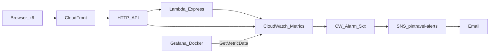
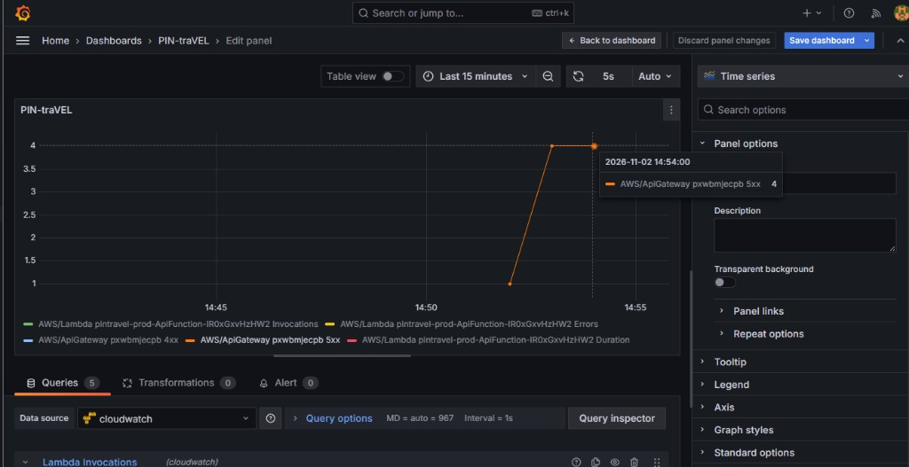
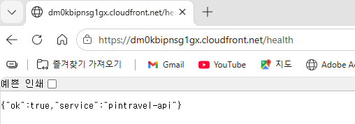
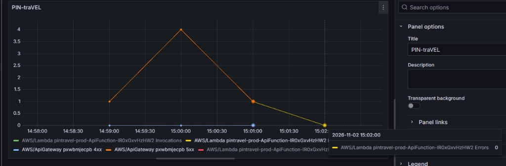
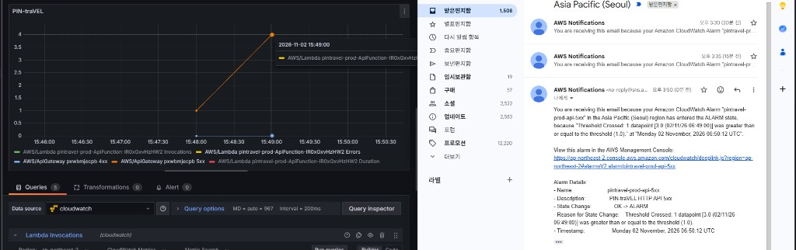

# Pintravel Grafana·CloudWatch 모니터링 실습 — 완료 보고서

작성일: 2026-11-02  
리전: `ap-northeast-2` (서울)  
스택: `pintravel-prod`  
사이트: `https://dm0kbipnsg1gx.cloudfront.net`

이미 올린 서버리스 1차 위에 **호출·오류를 한 화면에서 보고, 5xx 시 메일**이 오도록 한 기록이다. 절차 메모는 [observability-grafana.md](./observability-grafana.md), 배포 자체는 [aws-deploy-report.md](./aws-deploy-report.md)를 따른다.

---

## 1. 계획 목적

배포만 되어 있으면 장애는 CloudWatch 로그를 직접 열어야 보인다. 실습 목표는 다음이다.

| 계획 | 선택 |
|------|------|
| 보는 화면 | Grafana OSS (Docker, `localhost:3000`) |
| 지표 원천 | Amazon CloudWatch (Metrics). Grafana에는 **읽기 전용** IAM 키만 |
| 부하 | k6로 CloudFront `GET /health`만 (축제·일정 API 부하 없음) |
| 장애 재현 | SSM `MONGODB_URI`를 잠깐 틀린 값으로 덮은 뒤 **즉시 원복** |
| 알림 | CloudWatch 알람 → SNS → 이메일 |

성공 기준: Grafana에서 Lambda Invocations·Duration·API 4xx/5xx가 보이고, 의도한 5xx 구간에 그래프와 알람 메일의 시각이 맞으며, 원복 후 `/health`가 `{ "ok": true }`를 반환한다.

---

## 2. 최종 관측 경로



- Grafana는 AWS 안에 두지 않고 PC Docker로만 띄운다. 과금·계정 노출을 줄인다.
- 데이터소스 리전은 `ap-northeast-2`. Assume Role ARN·커스텀 Endpoint는 비워 둔다.
- 알람 지표는 Lambda Errors가 아니라 **API Gateway `5xx`** 이다. Express가 500 JSON을 돌려주면 Lambda Errors는 0으로 남을 수 있다.

대상 리소스:

| 구분 | 값 |
|------|-----|
| Lambda | `pintravel-prod-ApiFunction-IR0xGxvHzHW2` |
| HTTP API | `pxwbmjecpb` |
| 알람 | `pintravel-prod-api-5xx` (`AWS/ApiGateway` `5xx`, 1분 Sum ≥ 1) |
| SNS | `pintravel-alerts` |

---

## 3. 저장소에 넣은 산출물

| 경로 | 역할 |
|------|------|
| [`infra/observability/docker-compose.yml`](../infra/observability/docker-compose.yml) | Grafana 11.x `:3000` |
| [`scripts/k6-health.js`](../scripts/k6-health.js) | CloudFront `/health` 부하 (2 VU, 약 90초) |
| [`docs/observability-grafana.md`](./observability-grafana.md) | 사전 준비·실습 순서 |
| [`docs/observability-grafana-report.md`](./observability-grafana-report.md) | 이 완료 보고서 |
| [`docs/images/observability/`](./images/observability/) | GitHub에 올릴 캡처 |

---

## 4. 실제 수행 순서

### 4.1 사전 준비

- Docker Desktop, AWS CLI, k6.
- IAM `pintravel-grafana-read`에 CloudWatch 지표 읽기(`CloudWatchReadOnlyAccess` 등). Grafana에 관리자 키를 넣지 않음.
- 배포용 CLI로 SNS·알람을 만들고, Grafana는 읽기 키만 사용.

### 4.2 Grafana

`infra/observability`에서 `docker compose up -d` → `http://localhost:3000` (로컬 admin).  
CloudWatch 데이터소스 Save & test 성공 후 대시보드 **PIN-traVEL**:

- `AWS/Lambda` Invocations, Duration, Errors (FunctionName)
- `AWS/ApiGateway` 4xx, 5xx (ApiId `pxwbmjecpb`)

### 4.3 k6 (정상 구간)

`k6 run scripts/k6-health.js`. `/health`만 호출하므로 Mongo 축제 조회는 타지 않는다.  
1~3분 뒤 Invocations가 올랐고 Errors·5xx는 거의 0이었다. Duration은 콜드 스타트 때 한 번 튀는 경우가 있다.

### 4.4 장애 재현 후 원복

1. SSM `/pintravel/prod/MONGODB_URI`를 로컬에 백업.
2. 틀린 `mongodb+srv://`로 `put-parameter --overwrite`.
3. Lambda `update-function-configuration`으로 워커를 비움.
4. CloudFront `/health`를 여러 번 호출 → 500.
5. Grafana에서 API **5xx** 상승 확인.
6. 원래 URI로 덮고 Lambda를 다시 재시작.
7. `/health` → `{ "ok": true, "service": "pintravel-api" }`.

첫 재현(2026-11-02 14:54 KST)에서 5xx가 4까지 올랐다.



원복 직후 `/health`와 그래프가 내려오는 모습:





### 4.5 알람·메일

SNS 토픽 `pintravel-alerts`에 이메일 구독 후 Confirm.  
`put-metric-alarm`으로 `pintravel-prod-api-5xx` 생성.  
먼저 `set-alarm-state`로 메일 경로만 시험한 뒤, SSM을 다시 잠깐 틀어 **실제 5xx**로 알람을 울렸다.

2026-11-02 **15:49 KST** (= 06:49 UTC)에 Grafana 호출이 오르고, 같은 시각에 `OK → ALARM`, datapoint `3.0` ≥ threshold `1` 메일이 도착했다.



확인 후 SSM·Lambda를 다시 원복했다.

---

## 5. 발생한 문제와 해결

| 증상 | 원인 | 대응 |
|------|------|------|
| Grafana 데이터소스 실패·혼란 | Assume Role / Endpoint 자리 표시를 그대로 입력 | 리전·액세스 키만 채우고 Save & test |
| 패널에 네임스페이스가 안 보임 | 첫 Choose는 CloudWatch **Metrics** (네임스페이스가 아님) | Namespace `AWS/Lambda` 또는 `AWS/ApiGateway`는 그다음 |
| Duration 그래프가 Invocations처럼 보임 | 쿼리 Metric name이 Invocations로 남음 | Duration으로 바꾸고 저장 |
| 장애인데 Lambda Errors가 0 | 함수는 500을 반환하고 정상 종료 | 관측·알람은 API **5xx** |
| 시험 메일은 오는데 실제 장애 메일이 늦음 | 알람 주기 60초, 원복을 너무 빨리 하면 평가 전에 끝남 | `/health` 500을 1~2분 유지한 뒤 원복 |
| 시크릿 유출 위험 | URI를 채팅·Git에 붙임 | SSM get/put만 로컬, Git에는 이름만 |

---

## 6. 검증 결과 (완료)

| 항목 | 결과 |
|------|------|
| Grafana CloudWatch 데이터소스 | 통과 |
| 대시보드 Invocations / Duration / 4xx / 5xx | 통과 |
| k6 `/health` 후 Invocations 상승, 5xx ≈ 0 | 통과 |
| SSM 오설정 → `/health` 500 → Grafana 5xx | 통과 |
| SSM 원복 → `/health` ok | 통과 |
| SNS 구독 Confirm + `set-alarm-state` 시험 메일 | 통과 |
| 실제 5xx와 알람 메일 시각 일치 (15:49 KST / 06:49 UTC) | 통과 |
| 실습 종료 시 사이트 정상 | 통과 (원복 후) |

---

## 7. 명시적 범위 밖

- MongoDB Atlas 콘솔 메트릭, AWS X-Ray 전면 도입.
- Grafana Cloud 유료 워크스페이스, EC2에 Grafana 상시 가동.
- 일정 생성·축제 목록에 k6 부하.
- 프로덕션 SSM을 긴 시간 깨 둔 채 방치.

실사용자가 없어도 파이프라인(지표 → 그래프 → 알람)은 성립한다. 트래픽이 늘면 같은 패널에 점이 더 쌓일 뿐이다.

---

## 8. GitHub 문서에 캡처 넣기

이미지는 **저장소 안 파일**이어야 GitHub README/docs에 보인다. 채팅에만 올린 그림은 커밋되지 않는다.

1. PNG/JPG를 `docs/images/observability/` (또는 `docs/images/` 아래 원하는 폴더)에 복사한다.
2. 메일 주소·액세스 키·URI가 보이면 가리거나 자른다.
3. 마크다운에서 **그 `.md` 파일 기준 상대 경로**로 넣는다.

같은 폴더의 보고서에서:

```markdown

```

루트 `README.md`에서:

```markdown

```

파일 이름만 바꾸면 원하는 절 바로 아래에 붙이면 된다. 이번 실습 캡처는 아래 네 장이다.

| 파일 | 내용 |
|------|------|
| `grafana-5xx-first.png` | 첫 재현 14:54 KST, 5xx = 4 |
| `health-ok.png` | 원복 후 `/health` |
| `grafana-after-restore.png` | 5xx 하강 |
| `grafana-sns-alarm.png` | 15:49 그래프 + 알람 메일 |

---

## 9. 이후 운영 짧은 메모

- Grafana는 필요할 때만 `docker compose up -d`. 끄면 지표 수집은 CloudWatch가 계속한다.
- 알람을 끄려면 `aws cloudwatch delete-alarms --alarm-names pintravel-prod-api-5xx` 또는 콘솔에서 disable.
- Atlas 비밀번호를 바꾸면 SSM `MONGODB_URI`와 Lambda 재시작을 같이 한다. 이 실습과 같은 5xx·메일이 다시 나온다.
- k6는 `/health`만. 본문 API에 반복 호출하지 않는다.

---

## 10. 결론

Docker Grafana로 CloudWatch 지표를 묶고, k6로 정상 호출을 확인한 뒤, SSM Mongo URI 오설정으로 5xx를 재현·원복했다. API Gateway 5xx 알람과 SNS 메일이 **15:49 KST**에 그래프와 같이 울린 것을 확인했다. 관측 파이프라인은 여기까지가 1차 완료이다.
